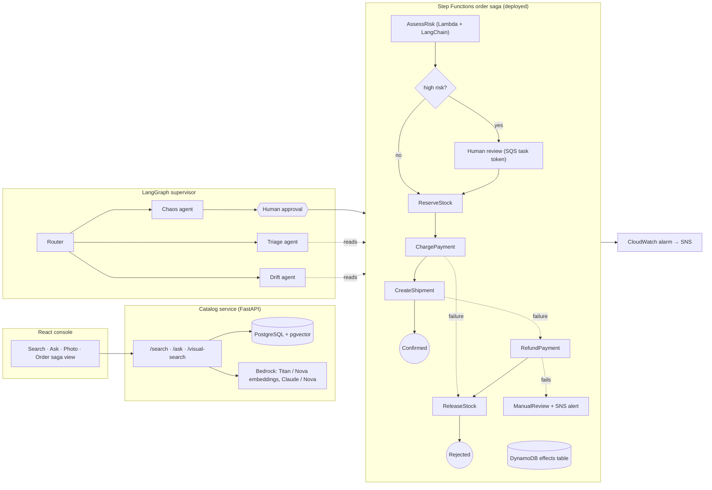

# Resilient Orders Platform

An order-processing platform on AWS built to be broken on purpose. It combines a semantic product search
service (hybrid retrieval and cited answers), two orchestration styles for the same order saga (AWS Step
Functions and LangGraph agents), a React operations console, and a set of agents that plan chaos experiments,
triage events and audit configuration, with a human approving anything that changes state.

Everything here was run and measured: the tests below pass, the workflow is deployed to a real AWS account,
and the numbers in [Results](#results) come from those runs.

## Status

| Area | State |
|---|---|
| Semantic catalog search (hybrid retrieval, cited answers, model fallback) | Built, evaluated, runs locally on PostgreSQL + pgvector |
| Multimodal search (text and photo, LlamaIndex router) | Built, evaluated |
| Order saga on Step Functions + Lambda | Built, tested locally, **deployed and exercised on AWS** |
| Resilience agents on LangGraph (chaos, triage, drift) | Built, **run live against the deployed saga** |
| React console (Redux Toolkit, XState) | Built, verified in a browser |
| Auto Scaling, ALB, ECS/Fargate, API Gateway | Not built yet |
| RDS/Aurora Multi-AZ, backup and restore, disaster recovery drills | Not built yet |
| CloudFront, AWS Config | Not built yet |

The vector store runs in a local Docker container, not yet on RDS. AWS Health is not available to the lab
account used here, so the triage agent reads a clearly labelled simulated feed.

## Architecture



## Results

All figures were measured on the data and AWS account described in [Limitations](#limitations).

**Retrieval quality** (32 products, 26 paraphrased queries, Titan Text Embeddings v2):

| Mode | recall@5 | MRR |
|---|---|---|
| Keyword only | 0.801 | 0.808 |
| Vector only | 0.987 | 0.869 |
| Hybrid (rank fusion) | 0.968 | 0.926 |

Vector search finds the most relevant products; hybrid ranks the right one first most often.

**Multimodal retrieval** (Nova multimodal embeddings): text query to product image, recall@5 0.98–1.00 depending
on whether image or caption vectors are searched; perturbed photo to product, recall@1 1.00. The images are
generated product cards, so this validates the pipeline and not real-world photo matching.

**Order saga on AWS** (5 fault-injection scenarios, real executions, see
[saga-lab-run.json](docs/results/saga-lab-run.json)):

| Scenario | Result | Duration |
|---|---|---|
| Healthy order | Confirmed; risk judged by Claude Haiku 4.5 | 34.6 s (cold start) |
| Payment fails twice then recovers | Retries absorb it; confirmed | 11.6 s |
| Shipping permanently down | Refund, then stock release; rejected | 18.9 s |
| Shipping and refund both down | Escalated to manual review; execution `FAILED` with `CompensationFailed` | 4.6 s |
| 9,000 order | Flagged high risk, paused for review, approved through the SQS task token; confirmed | 4.2 s |

**Agents, live** (reports in [docs/results/agent-runs](docs/results/agent-runs)): the chaos agent planned three
scenarios, a human approved, all three held their invariants. The drift agent found six configuration findings
on the deployed stack (no point-in-time recovery on the DynamoDB table, no X-Ray tracing, no reserved
concurrency, unencrypted SNS topics, no alarm on timed-out executions). The triage agent noticed that the
failure alarm raised by the broken-refund scenario was in `ALARM` state.

## What is in each part

**Catalog search** (`libs/catalog_core`). Hybrid search fuses pgvector similarity and full-text rank with
reciprocal rank fusion. It degrades in steps — hybrid, keyword only, then cached popular items — and every
response states which mode served it. `/ask` returns a grounded answer whose citations are validated against the
retrieved products, trying Claude Sonnet, then Haiku, then Nova, and ending with an extractive answer if no
model responds. Models and dimensions come from configuration.

**Multimodal engine** (`libs/catalog_core/multimodal`). A LlamaIndex router chooses between text search and
visual search, or both, for each request. Text and images share one embedding space (Amazon Nova multimodal
embeddings), so a photo or a sentence can find the same product.

**Step Functions saga** (`projects/orders_stepfunctions`). An 18-state workflow with an AI risk check, optional
human review, retried steps, reverse-order compensation, and escalation. The Lambdas are idempotent and accept
injected faults, so failure paths can be triggered on demand. Tests run the real workflow definition in Step
Functions Local with mocked integrations, covering retries, compensation order, escalation, review approval,
denial and timeout, and the risk-service outage fallback.

**LangGraph agents** (`projects/orders_langgraph`). A supervisor routes requests to three agents. The chaos agent
proposes experiments from a fixed catalogue and cannot start one until a human approves; outcomes are judged by
deterministic invariants, not by the model. Each agent has its own tool allowlist, write tools need an approval
flag, every call is audited, approvals are checkpointed so a paused run survives a restart, and every agent
still returns a rule-based result when no model is reachable.

**Console** (`apps/dashboard`). Redux Toolkit with RTK Query handles API state; XState machines model the search
lifecycle (retry with backoff, a degraded state, latest query wins) and the order saga, using the same state
names as the Step Functions workflow. A fault-injection selector sends a header that makes the local API fail a
dependency, so degraded behaviour is visible in the browser.

## Resilience patterns and where they are tested

| Pattern | Where | Test |
|---|---|---|
| Retry with exponential backoff and jitter | Step Functions steps, search machine | Step Functions Local scenarios, XState tests |
| Compensation (saga) | ASL workflow, XState machine | `ShipmentPermanentFailure`, order saga tests |
| Escalation when compensation fails | `ManualReview` state, failure alarm | `RefundFails`, live run |
| Graceful degradation | Search fallbacks, risk-model fallback, agent fallbacks | API chaos tests, `RiskServiceDown` |
| Idempotency | Lambda handlers, DynamoDB effects | Handler tests |
| Human-in-the-loop | `waitForTaskToken` review, agent approval interrupt | Workflow tests, agent tests |
| Dead-letter queue | Review queue | Stack template tests |
| Fault injection | Lambda `faults` input, API `X-Chaos` header | Used by the agents and the console |

## Getting started

Requirements: Python 3.12, Node 22 or later, Docker, and the AWS CLI (2.37 or later) for the AWS parts.
Run every command from the repository root.

```bash
python -m venv .venv
source .venv/bin/activate            # Windows: .venv\Scripts\activate
pip install -r requirements.txt
cp .env.example .env                 # set AWS_PROFILE; real credentials stay in your AWS CLI profile
docker compose up -d                 # local PostgreSQL with pgvector on port 5433
```

Credentials never go in the repository: `.env` is git-ignored and holds only a profile name and model ids.

The Python packages live under `libs/`, `services/` and `projects/`, so put them on the path once per shell:

```bash
export PYTHONPATH=libs:.:projects/orders_langgraph          # macOS, Linux
```
```powershell
$env:PYTHONPATH = "libs;.;projects/orders_langgraph"        # Windows PowerShell
```

(`pytest` sets its own path from `pytest.ini`.)

**Tests**

```bash
pytest                               # Python; Step Functions Local tests need the amazon/aws-stepfunctions-local image
cd apps/dashboard && npm install && npm test
```

**Search evaluation** (the offline run needs no AWS access)

```bash
python -m catalog_core.evaluate --embedder hash       # offline baseline
python -m catalog_core.evaluate --embedder bedrock    # Titan embeddings
python -m catalog_core.multimodal.evaluate            # Nova multimodal
```

**Console and API**

```bash
uvicorn services.catalog_api.app:app --port 8000
cd apps/dashboard && npm install && npm run dev       # http://127.0.0.1:5173, proxies /api to the service
```

**Deploy the saga to AWS** (cost is pay-per-use and close to zero when idle)

```bash
python scripts/session_guard.py                                   # checks credentials and which models answer
cd infra && npm install
npx cdk bootstrap
npx cdk deploy --outputs-file ../deploy-outputs.local.json
cd .. && python scripts/run_saga_scenarios.py --profile <profile> --outputs deploy-outputs.local.json
```

**Run the agents** (omit `--yes` to be asked before the chaos agent acts)

```bash
python -m resilience_agents \
  "Run a chaos experiment: see how the order workflow behaves when payments and shipping fail" --yes
```

**Tear down**

```bash
cd infra && npx cdk destroy --force && cd .. && docker compose down
```

## Cost and safety

- Deploying the saga creates only pay-per-use resources (Step Functions, Lambda, DynamoDB on demand, SQS, SNS,
  CloudWatch). Nothing in the stack bills while idle.
- The chaos agent runs at most five executions per plan, each costing a fraction of a cent plus one model call.
- Anything that starts an execution is gated by a human approval in code, not by instructions to the model.
- Reports and audit logs redact account ids and ARNs when written.

## Repository layout

```
apps/dashboard/                React console (Redux Toolkit, XState, Vite)
services/catalog_api/          FastAPI service over the catalog library
libs/catalog_core/             Hybrid search, cited RAG, multimodal engine, evaluation
projects/orders_stepfunctions/ Lambda handlers, workflow definition, Step Functions Local tests
projects/orders_langgraph/     Supervisor and agents, tool registry, audit log
infra/                         CDK app and stack
data/                          Product catalogue, evaluation queries, generated product images
scripts/                       Session guard, capability probes, scenario runner, image generator
docs/results/                  Measured results and agent reports
```

## Design decisions

- **The model proposes, rules judge.** Chaos verdicts and the risk floor come from deterministic checks, so a
  model can raise scrutiny but never lower it below policy.
- **Two orchestrators, one saga.** Step Functions runs state-changing work, which needs retries, durability and an
  audit trail. LangGraph agents handle diagnosis and planning, which need reasoning. An agent starts an
  execution but never makes the individual API calls itself.
- **Model fallback is a first-class behaviour.** Every model call walks a configured chain and records which
  model answered. This was needed in practice: some Claude models in the lab account became unavailable
  intermittently, so model ids live in configuration and each call degrades gracefully.
- **No NAT gateway or search cluster.** Both would dominate the cost of a small account for no benefit here.

## Limitations

- The catalogue is synthetic (32 products) and the product images are generated cards, so retrieval figures
  compare search modes and do not predict production accuracy.
- The saga steps are simulated services with fault injection; there is no real payment or shipping integration.
- Results come from one AWS lab account in us-east-1, where Claude 5.x models and AWS Health were unavailable.
- The drift agent proposes configuration changes but nothing applies them, and the proposed snippets are not
  tested.
- Compute, database and disaster-recovery layers listed under [Status](#status) are not built yet.
